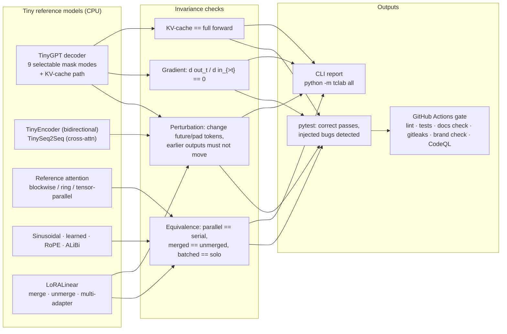

# Transformer Correctness Lab

> CPU-only, seconds-fast tests that prove a transformer's plumbing is right: no future-token leaks, padding that really is invisible, parallel attention that equals the serial math, position encodings that behave, and LoRA adapters that change only what they should.

**Recruiter summary**
- **Problem:** many transformer bugs (a transposed causal mask, a flipped boolean convention, pads that leak into pooling, a wrong RoPE offset in a KV cache) do not crash. Loss just looks a little too good or a little worse, and nobody notices for weeks.
- **Approach:** five test modules built on tiny PyTorch models. Each one runs the correct implementation, then deliberately injects known bugs and shows the test catches every one. The core idea is *black-box invariance testing*: change something the output must not depend on, and check the output did not move.
- **Proof (real run, CPU):** **88 tests** pass in about 2 seconds; the causal leak CLI classifies **9/9** mask implementations correctly (4 correct, 5 buggy); every injected bug in modules 2-5 is detected. All numbers below are pasted from real runs and re-checked in CI.

Author: Jagadish Meduri · personal learning portfolio · target roles: AI Engineer / Forward-Deployed Engineer.
Idea credit: the "Causal Mask Leak" breakdown in an *AI Interview Prep: Advanced NLP* newsletter series (#11). All code and wording here are my own.

---

## Contents
1. [Purpose and audience](#purpose-and-audience)
2. [Architecture](#architecture)
3. [Module map and learning path](#module-map-and-learning-path)
4. [How it works](#how-it-works)
5. [Real code and real output](#real-code-and-real-output)
6. [Use cases](#use-cases)
7. [How to run](#how-to-run)
8. [Guardrails and security](#guardrails-and-security)
9. [Limitations and known gaps](#limitations-and-known-gaps)
10. [Built vs planned](#built-vs-planned)
11. [Docs index](#docs-index)

## Purpose and audience
- **ML / AI engineers** who write or swap attention code, add padding or packing, change position encodings, or bolt on adapters, and want a cheap CI gate that catches silent correctness bugs.
- **Forward-deployed engineers** who adapt open models for a customer and need fast proof that their changes did not break the model's causal contract.
- **Interview prep and teaching:** every bug here is a classic interview question, with a runnable demonstration.

The models are tiny (2 layers, 32-dim) on purpose: see [docs/tiny-transformer.md](docs/tiny-transformer.md). The bugs are about *which positions can see which*, and that does not depend on model size.

## Architecture


## Module map and learning path
Work through them in order; each builds on the last.

| # | Module | Package / CLI | Correct vs injected bugs | Doc |
|---|---|---|---|---|
| 1 | Causal mask leak (+ padding, KV cache, packing, fp16/bf16) | `leaktest`, `python -m leaktest`, `python -m tclab leak` | 4 correct mask paths vs 5 buggy ones; plain causal vs block-diagonal packing; pads hidden vs not | [01](docs/01-causal-mask-leak.md) |
| 2 | Encoder and encoder-decoder masking | `tclab.encoder`, `python -m tclab encoder` | key-padding mask vs no mask / query-row mask; masked vs naive mean pooling; causal decoder + padded cross-attn vs two bugs | [02](docs/02-encoder-masks.md) |
| 3 | Parallel attention | `tclab.parallel`, `python -m tclab parallel` | online-softmax blockwise/ring attention vs missing rescale and chunk-local causal indices; tensor-parallel heads; batch invariance | [03](docs/03-parallel-attention.md) |
| 4 | Position encodings | `tclab.positions`, `python -m tclab positions` | RoPE relative property and KV offset; learned-position cliff; ALiBi; interpolation / NTK; left-pad position ids | [04](docs/04-position-encodings.md) |
| 5 | LoRA | `tclab.lora`, `python -m tclab lora` | zero-init B, frozen base, merge/unmerge, alpha/r scaling, adapter switching, causal mask preserved | [05](docs/05-lora.md) |

Interview talking points for every module: [docs/interview-points.md](docs/interview-points.md).

## How it works
1. **Build a tiny model with a known contract.** For a decoder: output at position *t* may depend only on tokens 0..t.
2. **Perturb something the output must not depend on.** Future tokens (decoder), pad tokens (encoder, pooling), other documents (packing), the batch neighbours (batch invariance).
3. **Compare with a tolerance** (`atol=1e-5` in fp32) and report the *first* position that moved.
4. **Cross-check with a second method.** Gradients (`d out_t / d in_{>t}` must be exactly 0) and KV-cache decoding (which physically cannot see the future) must agree with the perturbation test.
5. **Inject bugs on purpose.** Every check is shown to fail on a broken implementation, so a green test means something.

## Real code and real output
The core check (from [`leaktest/checks.py`](leaktest/checks.py)):
```python
for t in range(T - 1):
    for _ in range(trials):
        pert = tokens.clone()
        pert[:, t + 1 :] = torch.randint(0, vocab_size, pert[:, t + 1 :].shape, generator=g)
        out = fn(pert)
        diff = (out[:, : t + 1] - base[:, : t + 1]).abs().nan_to_num(nan=float("inf")).max().item()
        if diff > atol and rep.first_leak_position is None:
            rep.leaked = True
            rep.first_leak_position = t
```
The classic boolean-convention trap (from [`leaktest/masks.py`](leaktest/masks.py)):
```python
def sdpa_causal(T):   # F.scaled_dot_product_attention: True = ATTEND
    return torch.ones(T, T, dtype=torch.bool).tril()

def mha_causal(T):    # nn.MultiheadAttention:          True = BLOCK
    return torch.ones(T, T, dtype=torch.bool).triu(1)
```

`python -m leaktest --mask buggy_transpose` (real output, exit code 1):
<!-- OUTPUT:leak_buggy_transpose.txt -->
```text
mask mode : buggy_transpose
            BUG: upper triangle instead of lower (mask transposed)
  [LEAK] perturbation: positions_checked=11 max_abs_diff=4.662e-01 first_leak_position=0
      - output at position <= 0 changed by 1.029e-01 when tokens > 0 changed
  [LEAK] gradient: positions_checked=11 max_abs_diff=2.779e-01 first_leak_position=0
      - grad of output[0] wrt inputs > 0 is 8.438e-02
  [LEAK] kv_cache_vs_full: positions_checked=12 max_abs_diff=5.781e-01 first_leak_position=0
  verdict  : FUTURE-TOKEN LEAK DETECTED
```
<!-- /OUTPUT -->

`python -m leaktest --mask correct` (exit code 0):
<!-- OUTPUT:leak_correct.txt -->
```text
mask mode : correct
            SDPA with bool tril mask (True = attend) - correct
  [PASS] perturbation: positions_checked=11 max_abs_diff=0.000e+00
  [PASS] gradient: positions_checked=11 max_abs_diff=0.000e+00
  [PASS] kv_cache_vs_full: positions_checked=12 max_abs_diff=4.768e-07
  verdict  : causal (no leak)
```
<!-- /OUTPUT -->

Half-precision mask pitfalls (`leaktest/precision.py`):
<!-- OUTPUT:precision.txt -->
```text
fully_masked_row fp16: {'neg_inf_row0': [nan, nan, nan, nan], 'neg_inf_has_nan': True, 'finite_row0': [0.25, 0.25, 0.25, 0.25], 'finite_leaks_to_future': True}
fully_masked_row bf16: {'neg_inf_row0': [nan, nan, nan, nan], 'neg_inf_has_nan': True, 'finite_row0': [0.25, 0.25, 0.25, 0.25], 'finite_leaks_to_future': True}
finite_mask_too_small fp16: {'mask_-20_future_weight': 1.0, 'neg_inf_fp32_future_weight': 0.0}
fp16_min_overflow: {'fp16_min_plus_neg100': -inf, 'is_inf': True}
```
<!-- /OUTPUT -->

Full output for every module is in each module doc and in [`docs/output/`](docs/output).

Test run (`python -m pytest`, CPU, Python 3.13, torch 2.14.1+cpu):
```text
tests/test_cli.py .....                                                  [  5%]
tests/test_m1_causal_leak.py ...............................             [ 40%]
tests/test_m1_precision.py ......                                        [ 47%]
tests/test_m2_encoder.py ...........                                     [ 60%]
tests/test_m3_parallel.py .................                              [ 79%]
tests/test_m4_positions.py .........                                     [ 89%]
tests/test_m5_lora.py .........                                          [100%]

============================== 88 passed in 1.85s ==============================
```

## Use cases
Ten situations where these tests earn their keep, each with what goes wrong, how the test catches it, and the runnable test: [docs/USE_CASES.md](docs/USE_CASES.md).

| # | Use case | Runnable here |
|---|---|---|
| 1 | Reviewing custom attention code during pretraining | yes: 5 buggy mask modes |
| 2 | Switching attention backends / boolean convention flips | yes: SDPA vs MHA vs `is_causal` |
| 3 | fp16 / bf16 mixed-precision mask bugs and NaNs | yes |
| 4 | Padding + causal mask, left/right padding, variable-length batches | yes |
| 5 | KV-cache incremental decoding vs full forward | yes |
| 6 | Sequence packing with document boundaries | yes |
| 7 | Fine-tuning / LoRA adapter changes | yes |
| 8 | Model export / quantization regressions (ONNX, int8) | pattern only (see doc) |
| 9 | CI regression gate for model repos | yes: CLI exit codes + workflow |
| 10 | Interview / teaching demo | yes |

## How to run
Offline, CPU only, no cloud resources, no cost.
```bash
python -m venv .venv && source .venv/bin/activate
pip install torch --index-url https://download.pytorch.org/whl/cpu
pip install pytest ruff
python -m pytest                      # 88 tests, ~2 s
python -m tclab all                   # report for all five modules
python -m leaktest --mask buggy_transpose   # one mask mode; exit 1 = leak found
python -m leaktest --help
```
Maintainer scripts: `python scripts/count_tests.py` (prints the real test count), `bash scripts/regen_outputs.sh` + `python scripts/embed_outputs.py` (refresh captured outputs in the docs), `bash scripts/check_docs.sh` (CI check that docs match a fresh run), `python scripts/brand_check.py`.

## Guardrails and security
- No network calls, no credentials, no cloud resources. Everything runs on CPU.
- CI: actions pinned to full commit SHAs, pinned tool versions (`requirements-ci.txt`), least-privilege `permissions: contents: read`.
- gitleaks over full git history; CodeQL; Dependabot (major bumps not auto-merged).
- Docs check: README test count and every captured output must match a fresh run, so numbers cannot drift.
- Brand check: blocks real organisation names using a SHA-256 hashed blocklist (names never stored in plain text).
- Threat model and design decisions: [docs/threat-model.md](docs/threat-model.md), [docs/adr/](docs/adr).

## Limitations and known gaps
- **Tiny models, synthetic tokens.** These are correctness/regression checks, not quality benchmarks. Sample sizes: batch of 2 x 10-12 tokens, 2 random trials per position.
- **Perturbation testing is probabilistic.** A leak whose effect is below `atol` (e.g. a tiny weight on the future) can slip through; the gradient check is the stronger complement but needs a differentiable path from embeddings.
- **The MHA modes skip the gradient and KV-cache checks** (the tiny model's KV-cache path is SDPA-only). Perturbation still catches the MHA bug.
- **No GPU kernels tested.** FlashAttention-style kernels are represented by SDPA `is_causal=True` on CPU; on GPU the same test applies unchanged but was not run here.
- **ONNX / int8 export (use case 8) is documented as a pattern, not implemented.**
- **Learned-position cliff** uses a toy parity task; it demonstrates untrained embeddings, not a real LM's degradation curve.
- Captured outputs were produced with torch 2.14.1+cpu; tiny float differences (~1e-7) can vary by CPU, which the docs check normalises.

## Built vs planned
| Item | Status |
|---|---|
| Module 1 causal leak: perturbation, gradient, KV-cache checks, 9 mask modes, CLI | Built and run |
| Module 1 padding (left/right, variable length), packing, fp16/bf16 demos | Built and run |
| Modules 2-5 with tests and CLI subcommands | Built and run |
| GitHub Actions CI (lint, 88 tests, CLI for all modules, docs check, brand check, gitleaks over full history) | Built and passing on GitHub Actions |
| CodeQL code scanning | Active (repo is public; runs on push, PRs and weekly) |
| Dependabot version updates (pip, GitHub Actions) | Configured |
| Secret scanning, push protection, private vulnerability reporting | Enabled on the public repo |
| Repo rulesets (no force-push/deletion on `main`, required CI on PRs) | Planned |
| ONNX / int8 export consistency check | Planned |
| GPU / real FlashAttention kernel run | Planned |
| Hooking the leak test to a real open-weights model | Planned (see implementation guide) |

## Docs index
- [docs/tiny-transformer.md](docs/tiny-transformer.md): what a tiny transformer is and why size does not matter here
- [docs/01-causal-mask-leak.md](docs/01-causal-mask-leak.md) · [02](docs/02-encoder-masks.md) · [03](docs/03-parallel-attention.md) · [04](docs/04-position-encodings.md) · [05](docs/05-lora.md)
- [docs/USE_CASES.md](docs/USE_CASES.md)
- [docs/implementation-guide.md](docs/implementation-guide.md): adopt the tests in your own model's CI
- [docs/interview-points.md](docs/interview-points.md)
- [docs/threat-model.md](docs/threat-model.md) · [docs/adr/](docs/adr)

## Related repos
Other repos in the same portfolio (github.com/jagadishmazure-jpg) cover LLM evaluation and agent guardrails; this repo stays focused on model-internals correctness and links out instead of duplicating eval tooling.

## License
MIT, see [LICENSE](LICENSE).
